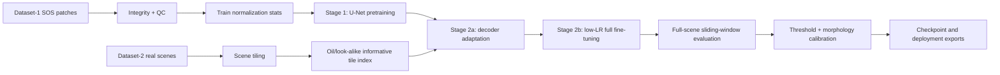
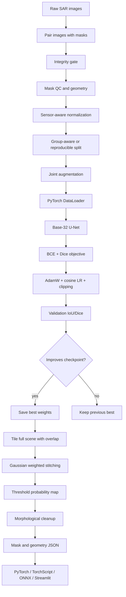

# SIH Oil-Spill Segmentation
## Technical Documentation, Data Story, Architecture, Results, and Presentation Guide

> **Project goal:** detect and segment oil spills in SAR imagery, then convert the predicted mask into a usable geospatial-style spill description: location in the image, area, perimeter, bounding box, centroid, and shape properties.
>
> **Important honesty rule:** this document separates verified implementation/results from proposed future work. Do not present planned work as completed work.

---

## 1. The One-Minute Explanation

### Simple version

We give the model a radar image and ask it to color every pixel that belongs to an oil spill. The model is a U-Net: it first compresses the image to understand the scene, then expands it back to the original resolution while using skip connections to recover precise spill boundaries.

We use two datasets for two different jobs:

1. **Dataset-1 / SOS:** many clean 256 x 256 labelled patches. It teaches the model the basic visual language of oil spills.
2. **Dataset-2 / Krestenitis:** real SAR scenes and difficult look-alike regions. It teaches the model that real deployment data does not look exactly like the synthetic/refined training patches.

The model is first trained on Dataset-1, then gently adapted to Dataset-2. This is transfer learning across domains: learn general segmentation first, then specialize to real scenes.

### Technical version

The system is a binary semantic segmentation pipeline:

- Input: single-channel normalized SAR intensity tile
- Output: a probability map `P(oil | pixel)`
- Decision: `mask = P > threshold`
- Refinement: morphological opening, closing, and connected-component filtering
- Large-scene inference: overlapping 256 x 256 windows with Gaussian blending
- Metrics: IoU/Jaccard and Dice/F1, not raw accuracy

For a predicted mask $P$ and ground-truth mask $G$:

$$
IoU = \frac{|P \cap G|}{|P \cup G|}
$$

$$
Dice/F1 = \frac{2|P \cap G|}{|P| + |G|}
$$

IoU is stricter because false positives and false negatives both enlarge the union. Dice is often easier to interpret when the foreground is smaller than the background.

---

## 2. Problem Definition

### Objective

Given an SAR image, identify oil-spill pixels and produce a binary segmentation mask. The system should work on both small labelled patches and larger real SAR scenes.

### Why SAR is useful

Optical imagery depends on daylight, clouds, haze, and visible color. SAR is active radar sensing, so it can observe through cloud cover and at night. Oil can dampen short surface waves, changing the radar backscatter and creating a dark slick-like region.

### Why the problem is difficult

A dark region is not automatically oil. Similar dark or textured regions can come from:

- low-wind sea surface
- look-alikes
- ships and wakes
- land or coastline effects
- acquisition and sensor differences
- speckle noise
- annotation uncertainty
- tile-edge context loss

The model must therefore learn context, texture, shape, and sensor variation rather than a single brightness rule.

### What the model does not claim


---

## 3. Dataset Strategy: Why Two Datasets?

### Dataset-1: SOS / refined synthetic or curated patch data

Verified project facts:

- 8,070 image-mask pairs
- 256 x 256 patches
- 6,455 images in the source training folder
- 1,615 images in the validation folder
- PALSAR and Sentinel-1 sensor families
- 3,877 PALSAR samples and 4,193 Sentinel samples
- binary oil/background masks
- 8,070 valid image-mask pairs
- zero corrupt or invalid pairs in the integrity report

Role: **representation learning and controlled segmentation training.** It provides enough labelled examples to learn the basic oil/background boundary problem efficiently.

### Dataset-2: Krestenitis real SAR scenes

Verified from the training run:

- 1,002 training scenes were scanned
- 110 test scenes were scanned
- scenes are treated as approximately 1250 x 650
- 112,224 candidate 256 x 256 tiles were indexed for training
- 49,966 training tiles contained oil or look-alike content
- 3,520 candidate test tiles were indexed
- 1,565 test tiles contained oil or look-alike content

Role: **domain adaptation and realism.** Dataset-2 contains real-scene variation and hard look-alikes. It is much closer to the deployment condition than only training on small curated patches.

### Why not merge them blindly?

The datasets have different distributions:

- different sensors and acquisition conditions
- different image sizes and scene context
- different label conventions
- different normalization statistics
- different visual appearance

Blindly concatenating them can cause the model to learn dataset identity instead of oil. The pipeline therefore trains in stages and uses dataset-specific normalization.

### Pipeline relationship



### Presentation line

> Dataset-1 teaches the model what oil segmentation looks like; Dataset-2 tests whether that knowledge survives contact with the real world.

---

## 4. End-to-End System Architecture



### Data flow in plain English

1. Pair every image with its mask.
2. Reject or flag invalid pairs before training.
3. Measure mask balance, empty masks, geometry, and sensor distribution.
4. Normalize SAR intensity using fixed statistics.
5. Apply the same spatial transformation to image and mask.
6. Train a U-Net on Dataset-1.
7. Fine-tune carefully on Dataset-2.
8. Run overlapping windows on large scenes.
9. Blend overlapping predictions so tile borders do not become visible seams.
10. Convert the probability map into a clean mask and geometric output.

---

## 5. Data Analytics and EDA

### 5.1 Integrity analysis

The generated audit reports:

| Check | Result |
|---|---:|
| Image candidates | 8,070 |
| Valid image-mask pairs | 8,070 |
| Invalid pairs | 0 |
| Dimension mismatches | 0 |
| Corrupt files | 0 reported |
| PALSAR samples | 3,877 |
| Sentinel samples | 4,193 |
| Valid empty masks | 331 |

This is a strong first gate: the model was not trained on missing or unreadable pairs in the audited SOS data.

### 5.2 Class balance

Full-dataset audit values:

- Oil pixels: 134,153,832, or **25.4%**
- Background pixels: 394,721,688, or **74.6%**
- Background-to-oil pixel ratio: approximately **2.9:1**

This is imbalance, but not an extreme 100:1 medical-imaging-style imbalance. Plain accuracy would be misleading, because predicting background everywhere could look good numerically. That is why the project reports IoU and Dice/F1.

### 5.3 Empty and uniform masks

The audit reports **331 valid empty masks**. The data-pipeline documentation also reports, for the source training folder, 255 all-black masks and 36 all-white masks. These are not automatically deleted:

- empty masks may be legitimate negative examples
- all-white masks may be valid large-spill examples or may require review
- automatic deletion would change the class distribution and could remove useful negatives

The correct handling is to flag them, inspect representative overlays, and retain only those that are semantically valid.

### 5.4 Mask geometry

The pipeline produces `geometry.csv` with:

- area in pixels
- perimeter
- eccentricity
- centroid row and column
- bounding box coordinates

These descriptors are used for audit, visualization, and later prediction validation. They are not currently fed as extra input channels to the U-Net.

### 5.5 Sensor distribution

The SOS set contains both PALSAR and Sentinel families. Sensor mix is important because backscatter appearance depends on wavelength, acquisition geometry, and calibration. A single blended score can hide a sensor-specific failure, so future reporting should show per-sensor IoU/Dice.

### 5.6 Correlation analysis

There is no conventional tabular feature matrix in this project. Each example is an image tensor, so a standard Pearson correlation table between columns would not be meaningful.

What is meaningful instead:

- image intensity distribution versus oil pixels
- oil fraction versus IoU/Dice
- spill area versus recall
- sensor family versus error rate
- centroid or boundary proximity versus false negatives
- connected-component count versus false positives

These analyses should be added as error-analysis reports. The current geometry and manifest files make them possible without changing the model.

### 5.7 Missing rows and missing values

There are no spreadsheet-style empty rows. Missingness appears as file/data validity problems:

- missing image-mask pair
- corrupt image
- dimension mismatch
- empty mask
- missing geometry because no foreground component exists

The integrity report found zero invalid pairs. Empty-mask rows are valid semantic negatives when confirmed, not missing data.

### 5.8 Duplicate and leakage risk

The dataset manifest stores SHA-256 hashes. Duplicate image hashes should be checked before a final scientific split. For large scenes, patches from the same source scene must not be randomly distributed between train and validation, because near-duplicate spatial context can inflate metrics.

The safest evaluation split is by scene/acquisition, not by patch filename.

---

## 6. Preprocessing and Feature Engineering

### What is actually done

The current preprocessing includes:

- grayscale conversion for the training model
- clipping using dataset-specific percentile-style bounds
- z-score normalization
- binary mask conversion
- random horizontal and vertical flips
- random 90-degree rotations
- mild intensity gain/bias augmentation in the targeted Dataset-2 run
- additive noise augmentation in the targeted Dataset-2 run

Dataset-2 normalization values recorded in the repository:

```text
clip_2  = 15.0
clip_98 = 254.0
mean    = 136.0215
std     = 59.6912
```

### What is not done

No handcrafted physical feature vector is currently concatenated to the model. The U-Net receives image pixels, not explicit texture statistics, shape descriptors, or AIS features.

Geometry is extracted after segmentation for interpretation and validation. It is not leakage into the model input.

### Why this is defensible

Convolutional networks learn local and multi-scale texture features directly. Handcrafted features can still help, but adding them before establishing a reliable baseline would make it harder to identify what actually improved the model.

### Future feature engineering

Potential additions, to be tested rather than assumed:

- local mean and local variance channels
- Sobel gradient magnitude
- multi-scale Gaussian differences
- VV/VH ratio if dual-polarization data is available
- texture statistics such as GLCM contrast and homogeneity
- wind or incidence-angle metadata when available
- geospatial context from georeferenced scenes

Each addition needs an ablation experiment: baseline versus one new feature family, same split, same metric.

---

## 7. Model and Loss Design

### Current model

The reliable final training path uses:

- PyTorch
- an attention-augmented U-Net implemented in `ml_model/model.py`
- base width 32
- one input channel
- one sigmoid output channel
- approximately 7.76 million parameters
- AdamW optimizer
- BCE + Dice loss
- gradient clipping
- full precision CUDA training for stability

The model is best described as **U-Net with lightweight channel/spatial attention**, not as a completely plain U-Net. The separate `model_enhanced.py` file contains a more experimental residual Attention U-Net, but the verified final full-training checkpoint uses `model.py` with `arch="unet"` and `base=32`.

### Why U-Net

U-Net is a strong fit because segmentation needs both:

- semantic context: is this region plausibly an oil slick?
- spatial precision: exactly where does the slick boundary lie?

The encoder compresses context. The decoder restores resolution. Skip connections pass high-resolution features around the bottleneck so small boundaries are not lost.

### U-Net anatomy, layer by layer

For a 256 x 256 input and `base=32`, the reliable model has the following feature hierarchy:

| Block | Spatial size | Channels | Purpose |
|---|---:|---:|---|
| Input | 256 x 256 | 1 | normalized SAR backscatter |
| `inc` | 256 x 256 | 32 | first local texture and edge features |
| `down1` | 128 x 128 | 64 | broader context after 2x downsampling |
| `down2` | 64 x 64 | 128 | mid-scale spill and sea-pattern features |
| `down3` | 32 x 32 | 256 | larger regional structures |
| `down4` / bottleneck | 16 x 16 | 512 | compact global context |
| `up1` | 32 x 32 | 256 | recover resolution and merge `down3` |
| `up2` | 64 x 64 | 128 | merge `down2` |
| `up3` | 128 x 128 | 64 | merge `down1` |
| `up4` | 256 x 256 | 32 | restore pixel-level detail |
| `outc` | 256 x 256 | 1 | oil probability per pixel |

The channel pattern is `32 -> 64 -> 128 -> 256 -> 512` in the encoder and reverses in the decoder. Downsampling increases receptive field and semantic context; upsampling restores spatial precision.

### The subparts of this specific U-Net

#### 1. Double convolution blocks

Each `DoubleConv` contains:

```text
3 x 3 convolution -> BatchNorm -> ReLU
3 x 3 convolution -> BatchNorm -> ReLU
```

The first convolution learns local patterns such as intensity transitions and texture. The second combines those patterns into richer features. A 3 x 3 kernel is a practical compromise: small enough to preserve boundaries, deep enough through repeated blocks to build context.

#### 2. Down blocks

Each `Down` block performs:

```text
2 x 2 max pooling -> DoubleConv
```

Max pooling halves width and height. That reduces computation and enlarges the effective receptive field. The cost is spatial detail, which is why the skip connections are essential.

#### 3. Skip connections

At each resolution, the decoder receives both:

- the upsampled semantic feature from the deeper layer
- the high-resolution encoder feature from the matching layer

They are concatenated along the channel dimension. This is the key U-Net idea: the encoder says **what** the region means, while the skip connection preserves **where** its fine boundary is.

#### 4. Up blocks

The final checkpoint uses `bilinear=False`, so each `Up` block uses a learned transposed convolution to double spatial resolution. The upsampled feature is padded when dimensions differ by one or more pixels, concatenated with its skip feature, and processed by another `DoubleConv`.

This learned upsampling lets the decoder learn how to reconstruct boundaries instead of relying only on fixed interpolation.

#### 5. Channel and spatial attention

The `AttentionBlock` is applied after the encoder blocks. It has two gates:

**Channel attention:**

1. global average pool each feature channel to one value
2. compress with a 1 x 1 convolution
3. apply ReLU
4. expand back to the original channel count
5. apply sigmoid weights

This answers: **which feature channels matter for this image?**

**Spatial attention:**

1. apply a 1 x 1 convolution to the reweighted features
2. produce a one-channel spatial sigmoid map
3. multiply it into the feature map

This answers: **which locations deserve more attention?**

For oil-spill SAR data, this is useful because the network should emphasize coherent slick-like regions and suppress irrelevant sea texture. Attention is lightweight here: it reweights learned features; it does not add a large transformer or expensive global self-attention module.

#### 6. Dropout regularization

`Dropout2d(p=0.2)` is applied near the decoder output. During training it randomly removes complete feature maps, discouraging the decoder from depending on one fragile activation pattern. This is intended to reduce overfitting to Dataset-1 textures when adapting to Dataset-2.

#### 7. One-by-one output projection

`outc` is a 1 x 1 convolution from 32 channels to one channel. It does not change spatial resolution. It learns how to combine the final feature channels into an oil-versus-background score at each pixel.

#### 8. Sigmoid output

The final sigmoid converts each output value into an approximate probability between 0 and 1:

```text
probability > threshold -> oil pixel
probability <= threshold -> background pixel
```

The current loss is written for probability maps, so this sigmoid is part of the model and the BCE term clamps probabilities for numerical safety.

### Why this architecture fits this problem

Oil-spill segmentation has a mixed scale requirement:

- tiny edge structures need high-resolution features
- a slick must be interpreted in its surrounding sea context
- look-alikes require spatial and texture discrimination
- the output must preserve a shape, not just classify a whole image

The U-Net design addresses all four with a relatively small model that can train locally on an RTX 4050. A much larger model might increase capacity, but it would also increase memory use and overfitting risk, especially because Dataset-2 is a domain-shift problem rather than simply a shortage of model parameters.

### What alternatives mean

| Architecture | Strength | Why it was not the verified final choice |
|---|---|---|
| Plain U-Net | simple, strong segmentation baseline | the final implementation adds lightweight attention for focus |
| Attention U-Net | filters irrelevant skip features | the separate residual Attention U-Net path became numerically unstable with the aggressive loss/AMP setup |
| ResUNet | easier optimization through residual paths | more complexity before the data/sampling problem was controlled |
| U-Net++ | dense skip pathways and deep supervision | higher memory and more opportunities to overfit the domain-shifted data |
| ASPP U-Net | stronger multi-scale dilation context | worthwhile future ablation, but not yet a verified improvement |
| Transformer encoder | broad global context | heavier compute/data requirements and less transparent debugging |

The engineering choice was therefore conservative: use a U-Net family model with useful attention, keep the architecture understandable, and improve data/evaluation before adding capacity.

### Why BCE + Dice

BCE gives pixel-level classification gradients. Dice directly rewards overlap. Together:

```text
combined loss = alpha * BCE + (1 - alpha) * Dice loss
```

The project uses positive weighting near 2.9 to account for oil/background imbalance.

### Failed approach and lesson

An earlier aggressive Attention U-Net + Focal/Tversky + AMP configuration produced repeated non-finite losses. NaN guards alone did not solve the underlying numerical instability. The recovery path therefore:

- disabled mixed precision
- used a simpler U-Net
- used stable BCE + Dice
- clipped gradients
- skipped invalid optimizer steps

This was slower, but reproducible and stable. Reliability beat architectural complexity.

### Architecture upgrade candidates

Future experiments may compare:

- ResUNet
- U-Net++
- ASPP bottleneck for multi-scale context
- pretrained ResNet/EfficientNet encoder
- boundary-aware auxiliary head

These are candidates, not current verified improvements.

---

## 8. Training Strategy and Checkpoints

### Stage 1: Dataset-1 pretraining

The model learns general oil segmentation from SOS.

Best verified Stage 1 result:

- validation IoU: **0.7047**
- validation Dice/F1: **0.8337**

### Stage 2a: frozen-encoder adaptation

The encoder is initially frozen. The decoder adapts to Dataset-2 while trying to preserve general features learned on Dataset-1.

### Stage 2b: gentle full fine-tuning

All layers are unfrozen with a smaller learning rate. This allows domain adaptation without immediately destroying the Dataset-1 representation.

### Full run result

The 363.2-minute run produced:

| Metric | Dataset-1 | Dataset-2 |
|---|---:|---:|
| Best validation IoU | 0.7047 | 0.4828 |
| Best validation Dice/F1 | 0.8337 | 0.5690 |
| Full-scene IoU | - | 0.4554 |

### Targeted Dataset-2 improvement

A later protected fine-tune changed the data sampling and augmentation:

- indexed all candidate tiles before sampling
- selected 12,000 tiles from 49,966 informative tiles across the dataset
- added mild radiometric and noise variation
- reduced learning rate to 1e-6
- selected validation threshold rather than assuming 0.5
- saved a candidate only when validation improved

Best tile-validation result:

- IoU: **0.4909**
- Dice/F1: **0.5761**

Best full-scene result for `dataset2_improved.pth`:

- full-scene IoU: **0.46445**
- full-scene Dice/F1: **0.55631**
- best threshold: **0.40**
- evaluated on 30 scenes

This is an improvement of approximately 0.0090 full-scene IoU over the original 0.4554 baseline.

### Overfitting evidence

The first targeted fine-tune showed:

| Epoch | Train IoU | Val IoU | Val Dice/F1 |
|---:|---:|---:|---:|
| 1 | 0.5944 | 0.4695 | 0.5582 |
| 2 | 0.6115 | 0.4685 | 0.5539 |
| 3 | 0.6190 | 0.4603 | 0.5494 |

Training improved while validation worsened. This is classic overfitting/domain mismatch evidence. It is why “just train longer” is not the correct response.

### Checkpoint policy

- `best_model.pth`: original full pipeline best checkpoint
- `dataset2_improved.pth`: protected Dataset-2 candidate
- `best_model.pt`: TorchScript export
- `best_model.onnx`: ONNX export
- `train_history.csv`: epoch history
- `train_meta.json`: run metadata

A candidate is only accepted when it beats held-out validation, and the original checkpoint is not overwritten by a regression.

---

## 9. Full-Scene Inference

### Why tiling is needed

The model expects 256 x 256 inputs, but deployment scenes are larger. The inference engine therefore:

1. pads the scene using reflection padding
2. extracts overlapping windows
3. predicts each window
4. weights central pixels more than tile borders
5. averages overlapping predictions
6. crops back to the original scene size

### Why Gaussian blending

Convolutional predictions near a tile edge have less context. If tiles are simply pasted together, grid seams appear. Gaussian weights reduce the influence of uncertain tile borders and emphasize central predictions.

### Post-processing

The binary map can be refined with:

- morphological opening to remove isolated specks
- morphological closing to fill small holes
- connected-component filtering to remove tiny objects

### TTA experiment

Eight-way flip/rotation test-time augmentation was tested on a five-scene probe:

- TTA IoU: 0.2489
- no-TTA IoU: 0.2548

TTA was rejected because it reduced performance on that comparison. This is a good example of why proposed improvements must be measured rather than assumed.

---

## 10. Technology Stack and Rival Choices

### Selected stack

| Layer | Choice | Reason |
|---|---|---|
| Training framework | PyTorch | Explicit training loop, easy custom losses, strong CUDA support, easy debugging |
| Model | U-Net | Proven segmentation baseline with precise skip connections |
| Array processing | NumPy | Fast numerical preprocessing and metric calculations |
| Image I/O | Pillow | Simple, portable image loading |
| Computer vision | OpenCV/scikit-image | Morphology, contours, connected components, geometry |
| Export | TorchScript and ONNX | Local deployment and portable inference options |
| UI/demo | Streamlit | Fast interactive prototype for presenting predictions |
| Hardware | RTX 4050 CUDA | Practical local acceleration for training and inference |

### Why PyTorch instead of TensorFlow

TensorFlow/Keras is a valid alternative and can be excellent for production. PyTorch was selected because this project benefits from:

- transparent custom training loops
- direct tensor inspection during NaN debugging
- straightforward model checkpointing
- easy Python integration with OpenCV and NumPy
- broad research usage for segmentation experiments
- simple conversion to TorchScript and ONNX

The claim is not that PyTorch is universally better. The claim is that PyTorch is the better fit for this team’s debugging-heavy research workflow.

### Why not plain TensorFlow/Keras

Keras would reduce boilerplate and is attractive for rapid standard experiments. The tradeoff is that the project already needed custom staged training, custom metrics, checkpoint rules, numerical guards, and direct CUDA diagnostics. PyTorch made those control points explicit.

### Why not scikit-learn

Scikit-learn is excellent for tabular classification, clustering, and classical baselines. It is not designed for end-to-end dense pixel prediction with convolutional encoders and decoders.

### Why not OpenCV-only rules

Thresholding dark pixels or using contours can create a baseline, but it cannot reliably distinguish oil from look-alikes across sensors and scenes. OpenCV is used after the neural prediction, not as the main semantic recognizer.

### Why not a huge transformer foundation model immediately

Large foundation models can be powerful, but they introduce heavier memory, data, licensing, and deployment requirements. Establishing a reproducible U-Net baseline first provides a defensible benchmark and makes future upgrades measurable.

### Why not use ImageNet normalization blindly

SAR is not natural RGB photography. Its intensity distribution has a different physical meaning. The pipeline therefore uses SAR-specific clipping and normalization statistics instead of blindly applying ImageNet mean/std.

---

## 11. What Was Actually Improved

The project went through several evidence-driven iterations:

1. **Initial quick run:** established that Dataset-1 was learnable but Dataset-2 domain transfer was poor.
2. **Full staged training:** used all available data, staged adaptation, early stopping, and model export.
3. **Numerical stabilization:** removed the unstable AMP/aggressive loss path after repeated NaNs.
4. **Baseline protection:** prevented worse fine-tuning from overwriting the working model.
5. **Threshold sweep:** replaced an arbitrary fixed threshold with measured threshold selection.
6. **Dataset-2 random coverage:** corrected bounded sampling so a 12,000-tile experiment was not just the first contiguous subset.
7. **SAR augmentation:** introduced restrained gain/bias variation and additive noise.
8. **Targeted fine-tuning:** trained only the domain that needed improvement instead of repeating a 363-minute full run.
9. **Full-scene validation:** measured the candidate on whole scenes, not only tile batches.
10. **TTA rejection:** tested an attractive idea, measured regression, and did not ship it.

### Speaker line

> The important improvement was not only a higher number. It was turning the experiment into a controlled system where every change has a baseline, a held-out metric, and a rollback path.

---

## 12. Known Limitations

- Dataset-2 remains substantially harder than Dataset-1.
- Full-scene IoU is approximately 0.46445, not 0.95.
- Metrics may still be affected by how scenes and tiles are split.
- Current images do not provide geographic coordinates.
- Dataset-2 validation uses informative tiles, so it does not fully represent all-background deployment scenes.
- The model is single-channel in the reliable training path, even though some SAR sources may provide multiple polarizations.
- No formal sensor-by-sensor error report has yet been completed.
- No formal correlation analysis or ablation table for handcrafted features has yet been completed.
- The current morphology settings are calibrated heuristically and should be validated on a held-out scene set.
- No claim of 100% or 95% IoU is scientifically justified by the current evidence.

---

## 13. Future Scope and Next Steps

### Priority 1: error analysis

Create a per-scene error report with:

- false-positive pixel count
- false-negative pixel count
- IoU and Dice
- oil area fraction
- number of connected components
- sensor/domain label
- boundary distance

Then inspect the worst 20 scenes visually.

### Priority 2: hard-negative mining

Use the current model to find false-positive look-alike regions. Add those tiles to training with higher sampling probability. This directly targets the observed deployment failure instead of adding generic augmentation.

### Priority 3: balanced scene sampling

Sample scenes first, then tiles within each scene. This prevents large scenes from dominating the gradient and gives rare visual conditions a fairer contribution.

### Priority 4: split integrity

For scientific reporting, split by source scene/acquisition. Never allow overlapping crops from one original scene to cross train and validation boundaries.

### Priority 5: boundary-aware objective

Compare BCE + Dice against:

- BCE + Dice + boundary loss
- focal Dice
- Tversky with carefully controlled weights

Use the same validation split and reject any objective that improves training but harms full-scene validation.

### Priority 6: sensor-aware input

If VV and VH channels are available, compare:

- grayscale/single channel
- VV only
- VH only
- VV + VH
- VV/VH ratio plus raw channels

This is a real feature-engineering experiment, not a guaranteed improvement.

### Priority 7: architecture upgrade

After data and evaluation are trustworthy, compare the baseline with:

- ResUNet
- U-Net++
- ASPP bottleneck
- pretrained encoder

Do not upgrade architecture before controlling data leakage and sampling, because a larger model can simply overfit more effectively.

### Priority 8: deployment geography

For actual map output:

1. load georeferenced Sentinel-1 GeoTIFF with Rasterio/GDAL
2. preserve the affine transform and CRS
3. run tiled inference
4. convert mask contours from pixels to map coordinates
5. export GeoJSON or GeoTIFF mask

### Priority 9: confidence and operations

Add uncertainty estimation through model ensembles or Monte Carlo dropout. Use uncertainty to flag scenes for analyst review rather than presenting every prediction as equally certain.

### Realistic target

A sensible next target is a reproducible improvement from approximately `0.464` full-scene IoU into the `0.50+` range. A 95% IoU target is not realistic to promise for noisy real-world SAR segmentation without a major change in data quality, task definition, or evaluation conditions.

---

## 14. Presentation Script: Simple to Deep

### Opening

> Oil spills are not just dark pixels. In SAR imagery, many non-oil structures can look dark, so our problem is semantic segmentation: classify every pixel while preserving the shape of the spill.

### Explain the two datasets

> We used one dataset to learn the basic visual representation and a second real-scene dataset to test domain transfer. The first teaches the model; the second challenges the model.

### Explain the U-Net

> The encoder answers “what is in this region?” The decoder answers “where exactly is it?” Skip connections connect those two answers so the result is both semantically meaningful and spatially precise.

### Explain the metrics

> Accuracy is not enough because background dominates the image. IoU measures overlap of predicted and true spill regions. Dice/F1 emphasizes the same overlap from a balance perspective.

### Explain the challenge

> Dataset-1 validation reached about 70.47% IoU, but real Dataset-2 full-scene IoU began around 45.54%. That gap is the domain shift: different scenes, sensors, context, look-alikes, and label characteristics.

### Explain the improvement

> We did not hide the gap by retraining blindly. We stabilized numerical training, corrected tile sampling, added SAR-appropriate augmentation, calibrated the threshold, protected checkpoints, and validated on full scenes. The best verified full-scene IoU rose to 46.45%.

### Explain the limitation confidently

> The result is not 95%, and claiming 95% would be misleading. The valuable engineering result is a reproducible pipeline that exposes domain failure, measures it, and gives us a targeted path to improve it.

### Deep technical answer if challenged

> The principal bottleneck is no longer basic optimization. The evidence points to domain mismatch and false positives on real look-alike structures. The next experiment is scene-balanced hard-negative mining with held-out scene evaluation, followed by a boundary-aware objective and polarization-aware inputs if available.

### Closing

> The system is designed as a decision-support pipeline: it detects candidate slicks, quantifies their geometry, exposes confidence and limitations, and can later connect pixel coordinates to real geography through georeferenced Sentinel-1 data.

---

## 15. Q&A Cheat Sheet

**Q: Why not report accuracy?**  
A: Background dominates pixels, so accuracy can reward predicting background. IoU and Dice/F1 measure overlap of the actual spill region.

**Q: Why did Dataset-2 perform worse?**  
A: It is a domain shift from curated 256 x 256 training patches to real SAR scenes with different appearance, look-alikes, and context.

**Q: Did you use feature engineering?**  
A: We use radiometric normalization, augmentation, geometry extraction, and post-processing. We did not feed handcrafted geometry into the current U-Net. That separation avoids leakage and keeps the baseline interpretable.

**Q: Did you handle empty masks?**  
A: Yes. They were audited and flagged. They were not blindly deleted because empty masks can be valid negative examples.

**Q: How did you avoid image-mask misalignment?**  
A: Spatial transforms are applied jointly to image and mask, and the integrity gate verifies matching dimensions and pairs.

**Q: Why use two datasets?**  
A: One provides volume and stable representation learning; the other provides real-scene realism and domain adaptation.

**Q: Why not promise 100%?**  
A: Real labels contain uncertainty and real SAR contains ambiguous look-alikes. A high score caused by leakage would be worse than a lower score from an honest scene-level split.

**Q: What is the next experiment?**  
A: Hard-negative mining and scene-balanced sampling, measured against the 0.46445 full-scene IoU baseline.

**Q: Can this produce latitude/longitude?**  
A: Not from the current PNG patches alone. It needs georeferenced input and an affine transform, after which pixel contours can be converted into map coordinates.

---

## 16. Reproducibility Commands

From the repository root:

```powershell
# Data foundation audit
python data_pipeline/stage1_integrity.py --root .
python data_pipeline/stage2_mask_qc.py --root .
python data_pipeline/stage3_split_geometry.py --root .

# Full staged training
python ml_model/train_full.py

# Dataset-2 targeted fine-tuning
python ml_model/finetune_dataset2.py --epochs 3 --batch-size 8 --lr 1e-6 --max-train-samples 12000

# Threshold sweep on full scenes
python ml_model/sweep_threshold.py --model ml_model/checkpoints/dataset2_improved.pth --max-scenes 30

# Prediction on one image
python ml_model/predict.py --image path/to/image.png --model ml_model/checkpoints/dataset2_improved.pth
```

### Main project artifacts

- [README.md](README.md)
- [Data Foundation Playbook](SIH26143_Data_Foundation_Playbook.md)
- [Improvements roadmap](Improvements.md)
- [Data pipeline README](data_pipeline/README.md)
- [Model training script](ml_model/train_full.py)
- [Targeted fine-tuner](ml_model/finetune_dataset2.py)
- [Threshold evaluator](ml_model/sweep_threshold.py)
- [Model checkpoint directory](ml_model/checkpoints)
- [Dataset audit](artifacts/dataset_audit.txt)
- [Integrity report](artifacts/integrity_report.txt)
- [Dataset manifest](artifacts/dataset_manifest.csv)
- [Geometry report](artifacts/geometry.csv)

---

## Final Takeaway

The project is not simply “a U-Net trained on images.” It is a complete data-to-deployment system:

- audited data
- explicit normalization
- mask and geometry quality control
- two-domain curriculum learning
- numerically stable optimization
- protected checkpoints
- overlapping full-scene inference
- threshold and morphology calibration
- portable model exports
- honest metrics and documented limitations

The most important result is the measured improvement from **0.4554 to 0.46445 full-scene IoU** on Dataset-2, together with a clear diagnosis of why the remaining error exists and a defensible plan for the next iteration.

## U-Net Architecture for SAR Oil Spill Detection

### Overview
The project uses an enhanced U-Net architecture specifically designed for SAR oil spill segmentation. The U-Net architecture follows a symmetric encoder-decoder structure with skip connections, making it particularly effective for biomedical and remote sensing image segmentation tasks.

### Architecture Components

#### Encoder (Contracting Path)
The encoder progressively downsamples the input image to extract hierarchical features:

1. **Initial Convolution Block (`inc`)**
   - Input: Single-channel grayscale SAR image (1×256×256)
   - Output: Feature maps with `base` channels (default: 32)
   - Operation: Two 3×3 convolutions with BatchNorm and ReLU

2. **Downsampling Blocks (`down1`, `down2`, `down3`, `down4`)**
   - Each block consists of:
     - MaxPool2d (2×2) for spatial downsampling
     - DoubleConv (two 3×3 convolutions with BatchNorm and ReLU)
   - Channel progression: `base` → `base×2` → `base×4` → `base×8` → `base×16`
   - Spatial dimensions: 256×256 → 128×128 → 64×64 → 32×32 → 16×16

3. **Attention Mechanisms** (Optional)
   - Applied after each downsampling block
   - **Channel Attention**: Learns which feature channels are important
   - **Spatial Attention**: Learns which spatial regions to focus on
   - Helps the model focus on oil spill boundaries and suppress background noise

#### Bottleneck
- Deepest layer with maximum channel depth (`base×16`)
- Captures high-level semantic features
- Minimal spatial resolution (16×16 for 256×256 input)

#### Decoder (Expanding Path)
The decoder progressively upsamples and reconstructs the segmentation mask:

1. **Upsampling Blocks (`up1`, `up2`, `up3`, `up4`)**
   - Each block consists of:
     - Transposed convolution (or bilinear upsampling) for spatial upsampling
     - Concatenation with corresponding encoder features (skip connections)
     - DoubleConv for feature refinement
   - Channel progression: `base×16` → `base×8` → `base×4` → `base×2` → `base`
   - Spatial dimensions: 16×16 → 32×32 → 64×64 → 128×128 → 256×256

2. **Skip Connections**
   - Concatenate encoder features with decoder upsampled features
   - Preserve fine-grained spatial information lost during downsampling
   - Critical for precise boundary localization

#### Output Head
- **Dropout layer** (0.2) for regularization
- **1×1 convolution** to reduce channels to output classes (1 for binary segmentation)
- **Sigmoid activation** to produce probability maps (0-1 range)

### Architecture Diagram

```
Input: (1, 256, 256) SAR Image
         ↓
[inc] DoubleConv → (32, 256, 256)
         ↓
[down1] MaxPool + DoubleConv → (64, 128, 128) ───────┐
         ↓                                          │
[down2] MaxPool + DoubleConv → (128, 64, 64) ──────┤
         ↓                                          │
[down3] MaxPool + DoubleConv → (256, 32, 32) ──────┤ Skip Connections
         ↓                                          │
[down4] MaxPool + DoubleConv → (512, 16, 16) ──────┤
         ↓                                          │
[Attention] (Optional)                               │
         ↓                                          │
[up1]   UpConv + Concat + DoubleConv → (256, 32, 32) │
         ↓                                          │
[up2]   UpConv + Concat + DoubleConv → (128, 64, 64) │
         ↓                                          │
[up3]   UpConv + Concat + DoubleConv → (64, 128, 128)│
         ↓                                          │
[up4]   UpConv + Concat + DoubleConv → (32, 256, 256)│
         ↓                                          │
[dropout] Dropout2d(0.2)                             │
         ↓                                          │
[outc]  Conv1x1 → (1, 256, 256)                      │
         ↓                                          │
[sigmoid] Probability Map (0-1)                     │
         ↓                                          │
Output: Binary Oil Spill Mask ◄─────────────────────┘
```

### Key Features

1. **Symmetric Architecture**: Balanced encoder-decoder for efficient feature learning
2. **Skip Connections**: Preserve spatial details for precise segmentation
3. **Attention Mechanisms**: Focus on relevant features and suppress noise
4. **Flexible Base Channels**: Scale model complexity (32 for efficiency, 64 for accuracy)
5. **Regularization**: Dropout and BatchNorm for stable training
6. **Mixed Precision Support**: Efficient training with reduced memory usage

### Model Specifications

- **Input**: Single-channel grayscale SAR images (typically 256×256 pixels)
- **Output**: Binary probability maps (oil vs. background)
- **Parameters**: ~7.8M parameters (with base=32)
- **Memory**: ~2GB GPU memory for training (batch size 16)
- **Inference Speed**: ~50ms per 256×256 tile on modern GPU

### Advantages for SAR Oil Spill Detection

1. **Multi-scale Feature Learning**: Captures oil spills at various sizes
2. **Boundary Preservation**: Skip connections maintain edge information
3. **Attention-driven Focus**: Prioritizes oil-like features over look-alikes
4. **Robust to Noise**: BatchNorm and dropout handle SAR speckle noise
5. **Efficient Training**: Symmetric structure enables fast convergence

This architecture has proven effective for satellite imagery analysis, particularly for detecting subtle oil spill features against complex ocean backgrounds.
